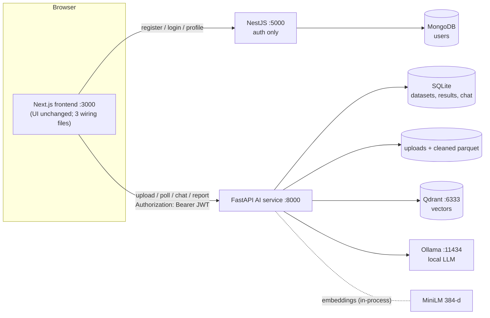
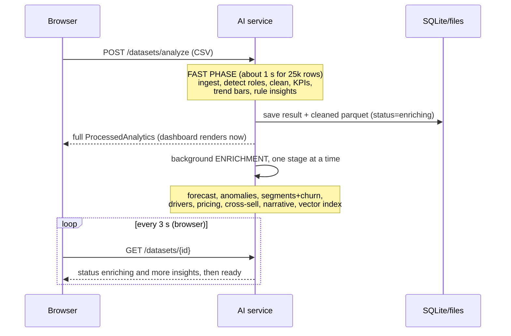
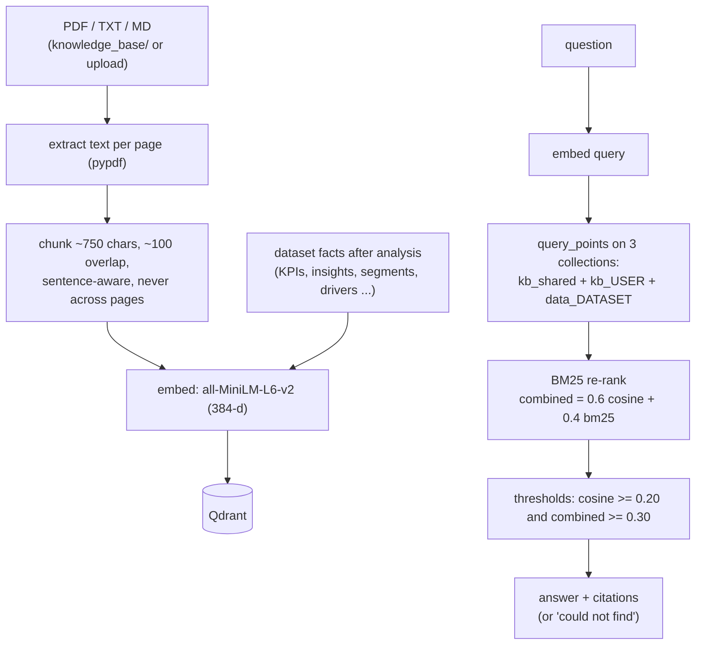
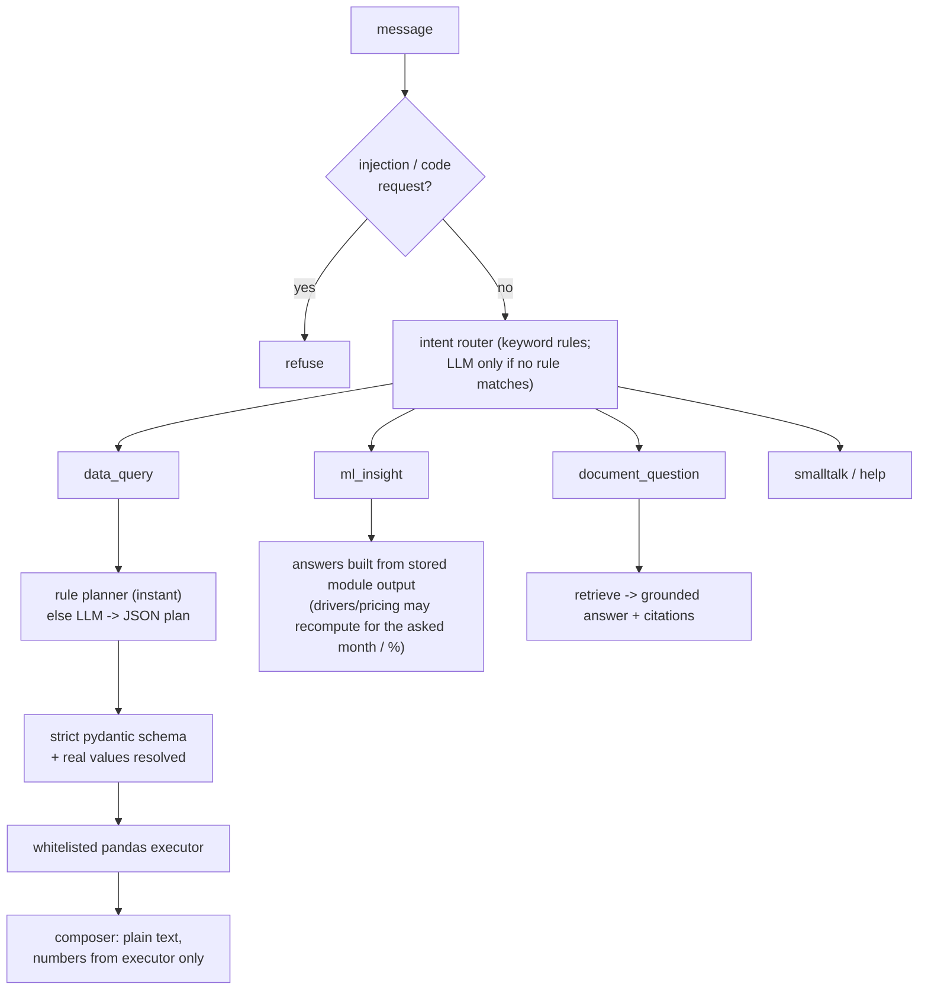

# Architecture

## 1. The big picture

**Why a "sidecar" service?** The teammate's NestJS + MongoDB + UI are a finished, separate piece of work. Putting all the data science
in a *separate Python service* means (a) zero changes to the frozen backend, (b) the right language for the job (pandas, scikit-learn,
statsmodels, SHAP), (c) the two halves can be shown, run and graded independently. The only thing they share is the **JWT secret**:
Nest signs the login token (HS256), the AI service verifies it with the same secret. No user table exists in the AI service.

**Trade-offs.** The browser talks to two servers (needs CORS and two base URLs); the AI service is stateful (SQLite + files), so it runs
as a single instance; local LLMs are slower and less fluent than hosted ones. In exchange: nothing leaves the machine, and there is no
API cost or key.

## 2. Upload: two phases

* **Fast phase** returns exactly the object the dashboard already consumes (`ProcessedAnalytics`), so the UI fills in immediately.
* **Enrichment** runs stage by stage; after each stage the result is saved, so insights appear progressively.
  A stage that throws is recorded (`{"status": "failed"}`) and the rest continue: **one failing module never fails the dataset**.
* Every ML module returns `status: ok | unreliable | skipped` plus a `reason`, so gaps are explained, never hidden.

## 3. Data pipeline (`app/pipeline/`)

`ingest.py` (encoding, delimiter, headers) → `roles.py` (what each column *is*) → `clean.py` (typed canonical frame + cleaning report +
quality score) → `kpis.py` → `trend.py` (bars in the exact `TrendBarItem` shape) → `rules.py` (README insight catalog) → `assemble.py`.

* **Role detection** scores each column against each role: 75% name match (exact / head-noun / fuzzy: `product_category` is a *category*,
  `customer_id` a *customer*) + 25% value check (dates parse, order ids are mostly unique, regions have low cardinality). A greedy
  one-to-one assignment gives every role a confidence that is shown to the user.
* **Per-unit cost.** Many CSVs store unit cost. The cleaner tests whether `cost <= unit price` on multi-unit rows and converts to line cost
  when needed. (Both original sample files are per-unit; the draft code mixed it with line revenue and produced wrong margins.)

## 4. RAG (`app/rag/`)

* **Isolation by collection:** `kb_<userId>` (private), `kb_shared` (the `knowledge_base/` folder, readable by all), `data_<datasetId>`
  (facts + dataset-scoped uploads; deleted with the dataset). Another user's collection is simply never queried.
* **Idempotent:** content hash per (owner, scope); an edited shared file replaces its old vectors; deleted files are removed.
* **Grounded:** an LLM answer is discarded unless every number in it appears in the retrieved excerpts; document text is sanitised
  (instruction-like lines removed) and the prompt declares it untrusted data.
* **Graceful degradation:** Qdrant down → chat says document search is unavailable but still answers data questions; embedding model not
  loadable → HTTP 503 with an actionable message; no Ollama → the most relevant passages are shown with a note.

## 5. Chat agent (`app/chat/`)

The model **never writes code and never supplies a number**. A *query plan* is data (operation, metric, group_by, filters, time range,
top_n, sort) validated against a closed schema; unknown columns, operations or extra fields are rejected before anything runs.
Follow-ups ("and for the West region?") reuse the previous plan stored per conversation.

## 6. Security model

* JWT (HS256, shared secret, `exp` required) on every route except `/health`; identity = token claims; every row/vector is scoped to the
  token's user id; another user's dataset → 403.
* Upload limits (type, size), sanitised file names, parameterised ORM queries, CORS restricted to configured origins.
* No `eval`/`exec`; prompt-injection guard on user text; retrieved text sanitised; dataset text sanitised before entering any prompt.
* No external network calls at runtime (one-time model downloads only).

## 7. Known limitations (be upfront at the viva)

* Single-instance service (SQLite, local files). Scale-out would need Postgres + object storage + a job queue.
* The real MiniLM retrieval thresholds are not calibrated on a labelled corpus (they could not be tuned in the build environment).
* Elasticity is *observational*: it measures association between price and quantity, not a controlled experiment.
* Forecasts are daily-revenue models; on noisy data they honestly report `unreliable`.
* Role detection is heuristic; low-confidence guesses are flagged, and the user can rename columns.
